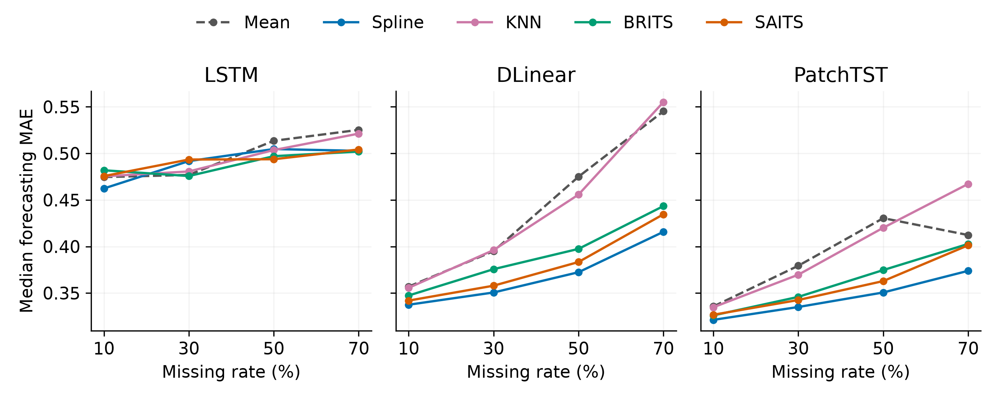

# Better Imputation Does Not Guarantee Better Forecasting

**Transmission Efficiency in Two-Step Time Series Pipelines**

Yu Chang, Qi Li, Sheng Feng, Huiqiao Hou, and Yujie Guo

This project investigates whether improving missing-value reconstruction also
improves downstream time series forecasting. We study the common **impute first,
then forecast** pipeline and measure how changes in imputation error relate to
changes in forecasting error across datasets, imputers, and forecasting models.

## Research question

An imputer can reconstruct missing observations accurately yet produce inputs
that are less useful to a forecasting model. Selecting an imputer by
reconstruction error alone may therefore lead to a different choice from
selecting it by downstream forecasting performance.

Our study examines this mismatch through matched comparisons with Mean
imputation. It quantifies both the transmission of error changes and **pure
inversion**: cases in which reconstruction improves while forecasting worsens.

## Method

For each experimental configuration, we compare imputation error (IE) and
forecasting error (FE) with the corresponding Mean-imputation baseline:

$$
\Delta IE = IE_{\mathrm{method}} - IE_{\mathrm{Mean}}, \qquad
\Delta FE = FE_{\mathrm{method}} - FE_{\mathrm{Mean}}.
$$

The configuration-level transmission ratio is

$$
\tau = \frac{\Delta FE}{\Delta IE}.
$$

Pure inversion means $\Delta IE < 0$ and $\Delta FE > 0$. The primary
MAE analysis excludes contrasts with $|\Delta IE| \leq 0.01$ to limit
small-denominator instability. Forecasting errors are averaged across three seeds
within each configuration before these comparisons. Relative error changes,
threshold sensitivity, seed consistency, dataset influence checks, and imputer-selection policies provide
complementary views of downstream performance.

The experimental protocol uses historical-window inputs: no observation after
the forecast origin is used as an input. Scaling and learned imputation
parameters are fitted on training data and then fixed for validation and testing.

## Experimental design

| Component | Settings |
| :--- | :--- |
| Datasets | ETTh1, KDD-Beijing, SWaT, Weather |
| Imputers | Mean, Spline, KNN, BRITS, SAITS |
| Forecasters | LSTM, DLinear, PatchTST |
| Missingness mechanisms | MCAR, Block-MCAR, MNAR |
| Missing rates | 10%, 30%, 50%, 70% |
| Forecast horizons | 24, 48, 96, 192 steps |
| Forecasting seeds | 42, 123, 2026 |
| Experiment size | 2,880 configurations; 8,640 recorded runs |

The archived label `MAR_Block` corresponds to the Block-MCAR mechanism described
in the manuscript.

## Main findings

| Result | Value |
| :--- | ---: |
| Median relative change in reconstruction MAE | -41.22% |
| Median relative change in forecasting MAE | -2.90% |
| Median transmission ratio | 0.0449 |
| Pure inversion among valid contrasts | 415 / 2,127 (19.51%) |
| Pure inversion after omitting each dataset in turn | 17.98%-22.53% |
| Forecasting-error-change sign agreement across all three seeds | 1,720 / 2,304 (74.65%) |

The primary error, ratio, and inversion summaries use 2,127 valid non-Mean
comparisons after averaging forecasting errors across seeds. The seed-agreement result uses all 2,304
non-Mean configurations, with upstream inputs held fixed across forecasting
seeds. Pure inversion also varies by forecaster: 34.41% for LSTM, 6.91% for
DLinear, and 17.21% for PatchTST, each among its valid comparisons.

Omitting each dataset in turn preserves the ordering of model-specific inversion
rates (LSTM > PatchTST > DLinear). This checks sensitivity to the composition of
the existing dataset grid; it is not a held-out-dataset forecasting experiment.

These results show that reconstruction accuracy alone is insufficient to assess
downstream forecasting performance under the evaluated settings. The
transmission ratio is a descriptive diagnostic; it is not a causal effect or a
percentage of reconstruction improvement transferred to forecasting.



*Figure 1. Median forecasting MAE across missing rates, grouped by forecasting
model and imputation method.*

## Reproduce the analyses

Clone the repository and install the analysis dependencies.

```sh
git clone https://github.com/SecretFzzf/shure.git
cd shure
python -m pip install -r analysis_support_upload/requirements.txt scipy
git archive --format=zip --output=../shure_revision_inputs.zip HEAD
```

From the repository root, reproduce the revision analyses from the archived
metrics and diagnostics. The ZIP created above supplies the same analytical
inputs as Online Resource 1.

```sh
python analysis_support_upload/07_revision_analysis/recompute_revision.py --esm ../shure_revision_inputs.zip --mask62-input analysis_support_upload/07_revision_analysis/mask62_input.csv --out ../shure_reproduced/revision
python analysis_support_upload/08_validation_temporal/recompute_server_followup.py --esm ../shure_revision_inputs.zip --inputs analysis_support_upload/08_validation_temporal --out ../shure_reproduced/validation
python analysis_support_upload/09_revision_checks/recompute_paired_and_signal.py --out ../shure_reproduced/paired
python analysis_support_upload/04_figure_generation/plot_three_seeds.py --only-figure-one --out ../shure_reproduced/figures
python analysis_support_upload/09_revision_checks/plot_single_column_figures.py --out ../shure_reproduced/figures
```

The first command produces the revised Figure 2 alongside its tables.
The final manuscript figures are in [04_figure_generation](analysis_support_upload/04_figure_generation/).
See the [reproduction guide](analysis_support_upload/README.md) for the
original analysis commands, the final manuscript table map and the inputs
needed to rerun the temporal block bootstrap.

## Repository contents

| Directory | Contents |
| --- | --- |
| [01_raw_data](analysis_support_upload/01_raw_data/) | Metrics from the original 8,640 runs and configuration audit |
| [02_transmission_analysis](analysis_support_upload/02_transmission_analysis/) | Transmission, inversion, seed checks and dataset influence |
| [03_selection_analysis](analysis_support_upload/03_selection_analysis/) | Imputer selection, regret and matched-missingness checks |
| [04_figure_generation](analysis_support_upload/04_figure_generation/) | Final manuscript figures and Figure 1 plotting script |
| [05_validation_manifests](analysis_support_upload/05_validation_manifests/) | Historical checksums and provenance for the original analysis |
| [06_signal_diagnostics](analysis_support_upload/06_signal_diagnostics/) | Signal summaries and archived out-of-fold predictions |
| [07_revision_analysis](analysis_support_upload/07_revision_analysis/) | Logistic regression, threshold and mask sensitivity, and Figure 2 generation |
| [08_validation_temporal](analysis_support_upload/08_validation_temporal/) | Validation metric comparison and temporal interval results |
| [09_revision_checks](analysis_support_upload/09_revision_checks/) | Coarser paired tests, signal sensitivities and Figures 3–4 generation |

The public signal audit retains file basenames and checksums. The temporal
intervals are supplied as archived outputs. Rerunning those intervals requires
the original per-origin error arrays.

## Data and code availability

This release provides archived experimental metrics and the code used to
recompute the numerical analyses and figures. The `01_raw_data` directory holds
run-level result records rather than original time-series observations.

Original datasets should be obtained from the sources described in the
manuscript; access to SWaT is subject to its provider's request and approval
process. Neither raw nor processed SWaT time series are redistributed. Upstream
preprocessing and model-training code, intermediate imputation arrays, and trained
weights are outside this release. Historical source manifests document the
original experiments; some referenced upstream files are not included here.

## Manuscript

**Better Imputation Does Not Guarantee Better Forecasting: Transmission
Efficiency in Two-Step Time Series Pipelines**

Yu Chang, Qi Li, Sheng Feng, Huiqiao Hou, and Yujie Guo.

Repository: <https://github.com/SecretFzzf/shure>
